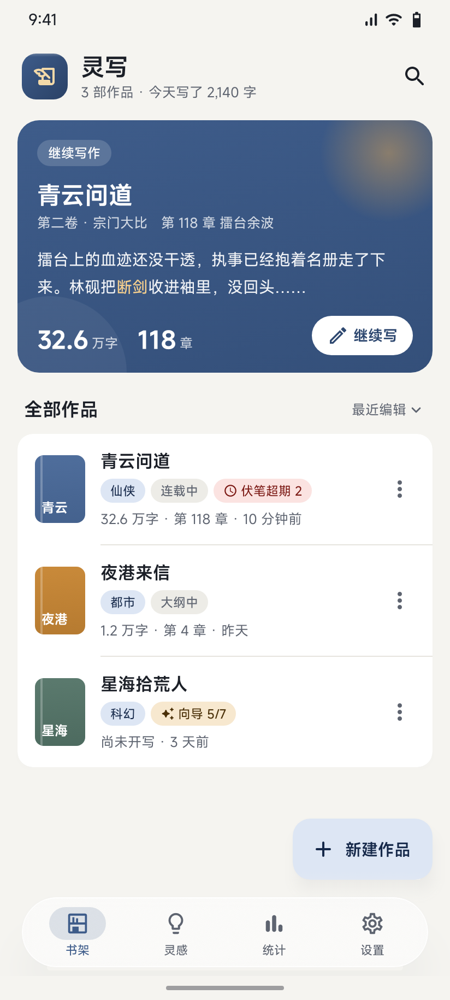
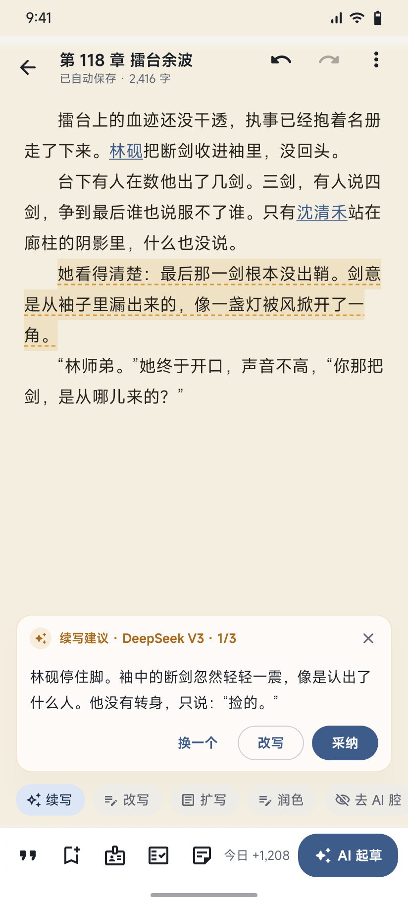
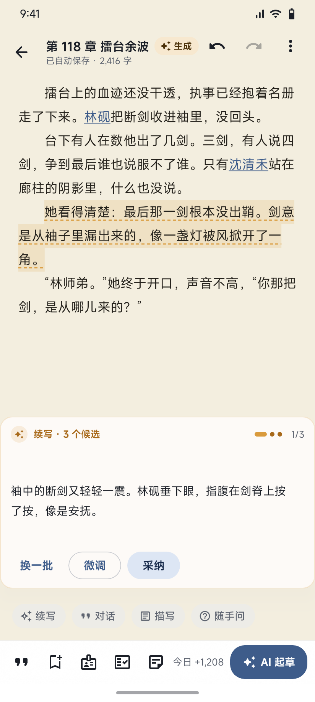
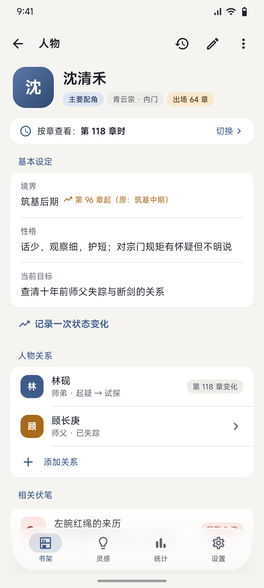

<p align="center"><b>简体中文</b> · <a href="README.en.md">English</a> · <a href="README.zh-TW.md">繁體中文</a> · <a href="README.ja.md">日本語</a></p>

# 灵写 LingWrite

写网文的安卓 App。章节编辑、设定库、三级大纲、伏笔台账、一致性检查，再加一套「帮你想，不替你写」的 AI 辅助。

- **数据全在本机**：没有服务器，没有账号，不收集统计。
- **模型你自己选**：DeepSeek、智谱 GLM、Kimi、Anthropic 兼容接口或任意 OpenAI 兼容接口，Key 只发给你选的服务商。
- **两种写法**：辅助模式只给方向、提问、指出问题，正文每个字都是你写的；生成模式可以起草，AI 段落会单独标出来。

<p>




</p>

## 功能

| | |
|---|---|
| 写作 | 首行缩进、自动保存、字数统计、撤销栈、历史版本与段落对比、本章便签 |
| 设定 | 人物/地点/势力等六类卡片，别名，按章生效的状态，关系图，地图标注 |
| 大纲 | 总纲 → 卷纲 → 章纲，多线视图，黄金三章检查，网文模板，总纲工作台 |
| AI | 续写/改写/扩写/润色/去 AI 腔，多候选，卡文急救，随手问，读者试读，拆文 |
| 长篇上下文 | 章摘要与卷摘要、按 token 预算裁剪、全文检索，可选语义检索 |
| 检查 | 一致性检查（人设/实力/时间线/关系），伏笔临期提醒，AI 味检查 |
| 其他 | 统计、导出 TXT/Markdown、整库备份、应用内更新（校验 SHA-256 和签名） |

## 下载

到 [Releases](https://github.com/WikG1018/lingwrite/releases) 下载最新的 `lingwrite-vX.Y.Z.apk`。每个版本的发布说明里都写着 `SHA-256:`，同目录也有 `.sha256` 文件，可以自己核对。

需要 Android 12（API 31）或更高版本。正式版签名证书的 SHA-256 是：

```
f31f5b4f455617f50337dc1bf1643023811d26464c3074e6cc706e4f1f3fce52
```

App 内「关于 → 检查更新」会访问本仓库的 Releases；GitHub 连不上时自动改走国内镜像。下载后先核对 SHA-256 和签名证书，不一致就不安装。

## 从源码构建

需要 JDK 17 和 Android SDK（compileSdk 37）。

```bash
git clone https://github.com/WikG1018/lingwrite.git
cd lingwrite/android
./gradlew assembleDebug          # 调试包
./gradlew testDebugUnitTest      # 单元测试和截图测试
./gradlew assembleRelease        # 没有签名配置时用 debug 签名
```

- **字体**：MiSans 不随仓库分发（原因见 [THIRD_PARTY_NOTICES](THIRD_PARTY_NOTICES.md)）。首次构建会从小米官方地址下载字体包（约 220 MB，缓存在 `~/.gradle/caches/lingwrite-misans/`），并逐个核对 SHA-256。离线或加 `-Plingwrite.misans=off` 时改用系统字体，构建照常通过。
- **签名**：仓库里没有任何签名密钥。自己打的 release 包用 debug 签名，不能覆盖安装官方版本。如需自签，按 `android/app/build.gradle.kts` 顶部的说明配置 `~/.lingwrite/signing.properties` 或环境变量。

## 隐私

作品、设定、大纲、备份都只存在你的手机上。API Key 用系统密钥库加密，不进备份。调用 AI 时，相关正文和设定只发给你自己配置的服务商；检查更新只访问 GitHub 或你选的镜像。详见 [PRIVACY.md](PRIVACY.md)。

## 参与贡献

欢迎提 Issue 和 PR。提交 PR 前请先读 [CONTRIBUTING.md](CONTRIBUTING.md)：为了保留双授权的可能，首次贡献需要签署 [CLA](CLA.md)。行为准则见 [CODE_OF_CONDUCT.md](CODE_OF_CONDUCT.md)，安全问题请按 [SECURITY.md](SECURITY.md) 私下报告。

## 开源协议

源代码以 [GNU AGPL-3.0](LICENSE) 授权（`SPDX-License-Identifier: AGPL-3.0-only`）。

第三方组件各有各的协议，见 [THIRD_PARTY_NOTICES.md](THIRD_PARTY_NOTICES.md)。**MiSans 字体不适用 AGPL**，它受小米《[MiSans 字体知识产权许可协议](https://hyperos.mi.com/font/zh/download)》约束（© 小米科技有限责任公司）。

## 商标

「灵写」「LingWrite」这两个名称和应用图标不在 AGPL 授权范围内。分发修改版时，请改名、换图标，并换掉包名 `com.lingwrite.app`。详见 [TRADEMARK.md](TRADEMARK.md)。

---

规划与设计文档（内部）：[docs/internal/README.md](docs/internal/README.md) · 开发进度：[PROGRESS.md](PROGRESS.md)
