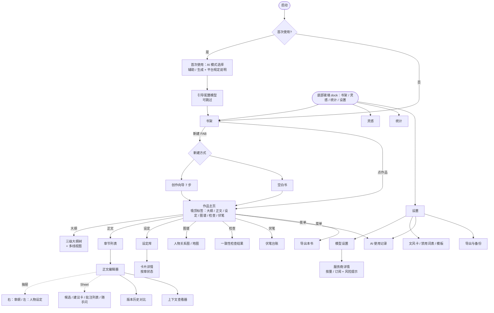

# 灵写 LingWrite · 界面规划 v0.2（2026-10-12）

> v0.2 变化：MVP 一次做完再发布，下文 P0/P1/P2 只表示**开发顺序**，不再表示分批发布；新增 3.17 统计页、3.18 检查更新、3.19 关于页、3.20 通知设置；新增第 6 节高保真稿。全局字体 MiSans（许可见计划 6.2）。

> 依据：novel-app-plan.md 第三版、plan-review.md。本文是低保真规划，不含代码。线框截图在 /workspace/ui-wireframes/。

## 1. 设计基调（沿用 ai-daily 的做法和质感）
- **技术与结构**：Jetpack Compose + Material 3；单 Activity + NavHost；页面内分区用**吸顶标签条 + HorizontalPager**；临时操作用 **ModalBottomSheet**；详情页通过 push 进入。
- **组件质感**：
  - 卡片圆角 12–14dp，1dp outlineVariant 描边，背景用卡片色。
  - 胶囊标签（Pill，圆角 50%）表示状态和分类；3dp 竖条色标表示来源或类型。
  - TopAppBar 与页面同底色；加载时用骨架屏。
- **字体**：MiSans（Regular / Medium / Semibold），缺失时回退系统字体。正文阅读排版沿用 bodyLarge 16.5sp / 行高 28sp，编辑器可调。
- **配色「黛蓝 · 暖灯」**：

| 角色 | 浅色 | 深色 |
|---|---|---|
| primary | #3E5C8A | #9DB4DE |
| tertiary（点缀，用于 AI 相关和提醒） | #D99A3C | #D99A3C（深色模式下可提亮到 #E5B266，需验证对比度） |
| background | #F5F4F0 | #0F1218 |
| surface / 卡片 | #FFFFFF | #181C24 |
| 正文 onSurface | #1B1F27 | #E4E7EE |

- **语义色**（ExtraColors，补充值待在 Material Theme Builder 中生成并验证对比度）：
  - AI 来源竖条：琥珀色表示"AI 生成"，琥珀色描边加主色表示"AI 建议 + 人工修改"。
  - 一致性问题：警示红。
  - 伏笔：主色浅底；超期为警示红。
  - 订阅风险：琥珀底加深色文字。
- **主色使用克制**：只用在主按钮、选中态、FAB、链接；大面积保持纸感中性色。
- **深浅色**：跟随系统 / 浅色 / 深色三档。编辑器正文背景（纸色 #F3EEDF / 护眼 #E3EDD9 / 纯黑 #000000〔建议值〕）独立于 App 主题。深色模式下 AI 标记竖条亮度降低，避免刺眼。

## 2. 信息架构与导航

- **底部悬浮玻璃 dock（v0.2 改，取代原"无底部导航"）**：四个顶层入口：书架、灵感、统计、设置。选中的入口用主色，图标填充，背后加 16% 主色的胶囊底。
  - **灵感**：跨作品的灵感速记和随手问记录，可以转成设定卡或伏笔。**统计**：3.17 统计页，再加上写作字数统计。**设置**：设置只从 dock 进入。书架顶部原来的设置按钮已删除（v0.1.0 真机反馈：与 dock 入口重复、交互冲突，已决），书架顶部只保留搜索。
  - **显示范围**：书架、作品主页、设定库 / 设定卡、模型设置、统计、灵感、设置这些顶层和浏览页显示 dock；编辑器、首次使用、创作向导、版本对比、全屏 Sheet 隐藏 dock，进入时 dock 下滑淡出。在作品内时，"书架"保持选中。
  - **外观**：圆角胶囊，高 64dp，左右各留 20dp，离屏幕底边 30dp，避开系统手势条（加上 navigationBars insets）。半透明底（浅色 白 62% / 深色 #202530 58%）+ 背景模糊约 22dp。1dp 描边：浅色 白 75%，深色 白 10%；顶部内侧 1px 高光；阴影轻（浅色 y8 blur24 16%，深色更重）。
  - **避让**：可滚动内容的 contentPadding 底部 = dock 高度 + 底边距 + 16dp（约 110dp）。dock 下方再垫一层 72dp 的背景色渐变，免得内容在手势条附近穿帮。FAB（新建作品、写下一章）上移到 dock 上方（bottom 约 110dp）。模型设置不再用 FAB，"添加服务商"改为列表最后一行。
  - **Compose 实现**：Scaffold 的 bottomBar 留空，dock 叠在 Box 顶层。
    - Android 12+（API 31）：用 Haze 库（或自写 `graphicsLayer { renderEffect = RenderEffect.createBlurEffect(...) }`）对 dock 背后的内容层取样做模糊；不能直接对 dock 自身做模糊，那样只会糊掉 dock 的内容。
    - 不支持模糊、或系统开了"减少透明度 / 省电"时，降级为 92% 不透明纯色（surfaceContainer），描边和阴影不变。
    - minSdk 是 31，所以降级路径主要用于低端机性能开关和截图测试。〔Haze 版本和性能在 M1 实测〕
- 作品主页内使用吸顶标签条 + Pager，标签可以横向滚动；"图谱"标签内再分关系图和地图两段。

## 3. 页面规划
优先级标注：**P0** = v0.1 必需（按 plan-review 建议的分期）；**P1** = v0.2；**P2** = v0.3。如果不分期，全部都在 MVP 内。

### 3.1 首次使用：AI 模式选择（P0）
- **布局**：全屏分步页。两张大卡片并排（窄屏改为上下排列），分别是"辅助模式：AI 出点子、批注，正文由你写"和"生成模式：AI 可以续写、改写正文"，两张卡片视觉权重相同，**没有默认选中**。下方折叠区"平台规定说明"列出起点、番茄的要点，附来源链接。
- **交互**：必须选一个才能继续；提示"之后可以在设置或编辑器里随时切换"。下一步是模型配置引导（可跳过）。
- **空状态**：无。

### 3.2 书架（P0）
- **布局**：TopAppBar（App 名 + 搜索 + 设置）。作品卡片列表：书名、题材胶囊、总字数、章节数、最近编辑时间、当前卷 / 章、伏笔超期数（红色胶囊，有才显示）。右下角 FAB"新建"。
- **交互**：点卡片进入作品主页；长按弹 BottomSheet（重命名、导出、复制、删除）。点"新建"后弹 Sheet 选择"创作向导"或"空白书"。
- **空状态**：插画占位 + "写下第一本书"，两个按钮：用向导开书 / 新建空白书。

### 3.3 创作向导（P1）
- **共用布局**：顶部步骤进度条（7 格，可点击已完成的步骤回改）+ 本步标题；正文区上方是"说明"卡（可折叠）和"示例"链接；底部固定按钮"跳过""AI 生成""下一步"。
- **AI 结果**：以建议卡显示，每张卡有"采纳 / 编辑后采纳 / 丢弃"（建议卡微调规则同 3.6）。

| 步骤 | 关键组件 |
|---|---|
| 1 灵感 | 多行输入框（一句话）；生成 3 张"方向梗概"卡，可单选或"融合" |
| 2 类型文风 | 题材胶囊多选；模板卡（黄金三章、开篇钩子、章尾悬念、感情线推进）；目标读者胶囊；"上传样章学文风"按钮，生成文风卡预览 |
| 3 人物 | 人物建议卡列表（姓名、身份、性格、动机、金手指），采纳后进入设定库 |
| 4 世界观 | 分组：力量体系 / 势力 / 地点，各自一组建议卡 |
| 5 总纲和卷纲 | 总纲文本卡 + 第一卷卷纲卡，可编辑 |
| 6 书名和简介 | 5 个书名胶囊（可点选）+ 2–3 版简介卡 |
| 7 前三章章纲 | 三张章纲卡（核心事件 / 开篇钩子 / 章尾悬念），下方是黄金三章检查表（通过 ✓ / 待改 ! 两种状态） |

- **完成**：进入作品主页的"正文"标签，第一章已建好。

### 3.4 作品主页（P0）
- **布局**：TopAppBar（书名、更多菜单：导出、AI 使用记录、作品设置、文风卡）。下面是吸顶标签条：**大纲 · 正文 · 设定 · 图谱 · 检查 · 伏笔**，内容用 HorizontalPager 横滑切换。
- **"正文"分页**（默认分页）：按卷分组的章节列表，每章一张卡：章名、字数、章纲完成度胶囊（未写 / 写作中 / 已完成）、AI 来源占比细条、检查问题数。FAB"新章节"。
- **空状态**：每个分页都有一句引导和一个主按钮，例如设定分页"还没有设定卡 · 新建 / 从已写章节提取"。

### 3.5 正文编辑器（P0）
- **写作区**：沉浸式。顶栏只有返回、章名、字数（点击显示目标进度）、模式开关胶囊（辅助 / 生成）、更多（版本历史、上下文查看器、排版设置）。正文使用独立背景色。
- **AI 来源标记**：段落左侧 3dp 竖条。琥珀色实线表示 AI 生成；琥珀色虚线表示 AI 建议 + 人工修改；手写段落无标记。点击竖条显示来源详情。
- **键盘上方小 AI 按钮**：键盘上方左侧有一个圆形小按钮（✦），点开是两项：**续写 / 随手问**，不遮挡输入。
- **选中文字工具条**：浮在选区上方的胶囊工具条：**改写 · 扩写 · 精简 · 描写 · 换语气 · 批注 · 标为伏笔**。
- **结果呈现**：
  - 生成模式下续写：底部 Sheet 里横滑 2–3 张候选卡，带长度滑杆（短 / 一段 / 多段）；"插入"后段落带 AI 标记。改写类：Sheet 中显示新旧对比（删除线 / 下划线），可以"替换 / 编辑后替换 / 放弃"。
  - 辅助模式下：结果以**建议卡**挂在段落旁（窄屏上是段落下方折叠的琥珀色小卡），不改正文；续写给"2–3 个方向卡"（推断的交互，见 plan-review B7）。
- **批注列表**：右下角批注数徽标，点开是 BottomSheet：批注列表（引用原文 + 批注内容）、"全部发给 AI"按钮。返回的建议逐条显示为建议卡：接受 / 编辑后接受 / 拒绝，顶部有"全部接受 / 全部拒绝"；应用前自动存版本，Sheet 顶部提示"已存版本，可回滚"。
- **建议卡微调**：点"编辑后采纳"后，卡片原地变成可编辑文本框（保留 diff 高亮），确认后来源标记为"AI 建议 + 人工修改"。
- **侧边抽屉**：
  - 右滑：章纲（核心事件、开篇钩子、章尾悬念 + 自定义字段），可编辑，顶部是完成度提示。
  - 左滑：本章出场人物和设定卡（当章状态），点击展开详情，可以从这里"始终带入 / 永不带入"。
- **随手问**：右侧面板（窄屏上为半高 Sheet），聊天式问答，回答底部有"复制 / 存为设定卡"，内容不进正文。
- **空状态**：新章节显示章纲摘要占位："本章要写：{核心事件}"，以及"开始写"提示。

### 3.6 设定库与卡片详情（P0）
- **设定库分页**：顶部分类胶囊（全部 · 人物 · 势力 · 地点 · 物品 · 能力体系 · 名词）+ 搜索。卡片网格（两列）显示名称、别名、类型色条、当前章状态摘要、带入方式小图标。顶部可能出现"AI 建议 3 张新卡 / 2 处更新"横幅，点开逐条处理。
- **卡片详情**：头部是名称、别名胶囊、类型、带入方式（自动 / 始终 / 永不）。**按章状态时间轴**：竖向时间轴，每个节点为"第 x–y 章：状态"，可以新增状态。下面是自定义字段、关系（人物卡）、出场章节列表（来自索引）、关联伏笔。
- **空状态**：说明"设定卡会在 AI 写作时自动带入"，提供"新建"和"从已写章节提取"按钮。

### 3.7 人物关系图（P2）
- **布局**：画布（可缩放、平移），节点是人物头像圆（首字）加名字，连线上标关系胶囊。底部是**章节滑块**，拖动查看某章时的关系，变化的边高亮。
- **交互**：点节点打开卡片详情的 Sheet；长按两节点之间可以新建关系。
- **空状态**：人物卡少于 2 张时，提示先创建人物。

### 3.8 地图 / 势力分布（P2）
- **布局**：用户上传的地图图片作为底图，地点为图钉，势力范围为半透明多边形。顶部工具：打点 / 画区域 / 图层（地点、势力）开关；底部章节滑块。
- **交互**：点图钉或区域弹出关联的卡片；画完区域后选择关联的势力卡。
- **空状态**："上传你的地图（手绘拍照也可以）"按钮。

### 3.9 三级大纲树与多线视图（P0 / 多线视图 P2）
- **大纲树**：顶部是总纲卡（可折叠）；卷节点为分组卡，章节点为行（章名、三字段缩略、完成度胶囊、线索色点）。拖动手柄调序；卷右侧"AI 拆章纲"按钮。
- **多线视图**：横轴为章、纵轴为线索的泳道表格，每格有点表示该章推进了这条线。一条线中断超过阈值后显示红色"已断 N 章"。窄屏可以横向滚动。
- **空状态**：总纲为空时显示"写一句话总纲，或让 AI 帮你拆"。

### 3.10 一致性检查结果（P1）
- **布局**：顶部是检查范围（本章 / 指定范围）和"重新检查"按钮，自动检查开关在作品设置里。问题按严重度分组：卡片显示问题类型胶囊（人设 / 等级 / 时间线 / 关系）、原文引用、设定依据引用。
- **操作**：跳转原文 / 故意为之（可附一句说明）/ 忽略本次。已处理的问题收到"已处理"折叠区。
- **空状态**："本章没有发现问题"，并显示上次检查时间。

### 3.11 伏笔台账（P1）
- **布局**：筛选胶囊（全部 / 未回收 / 即将回收 / 超期 / 已回收 / 放弃）；列表卡显示伏笔内容、埋设章 → 计划回收章、状态胶囊，超期整卡带红色竖条。顶部是"AI 建议的伏笔"横幅。
- **交互**：点卡片显示埋设原文，可跳转；滑动可改状态。
- **空状态**："在正文选中文字 → 标为伏笔"的示意。

### 3.12 AI 使用记录（P0）
- **布局**：按日期分组的时间线：任务类型胶囊（续写 / 改写 / 问答 / 检查…）、章节、模型、token 数、结果胶囊（原样采纳 / 修改后采纳 / 拒绝）。顶部是本书或全局切换、按章筛选、导出按钮。
- **说明条**：固定显示"本记录仅供自查，不是平台认可的证明"。
- **空状态**："还没有 AI 调用记录"。

### 3.13 版本历史对比（P0）
- **布局**：版本列表（时间、来源：自动 / 手动 / AI 采纳前、字数变化）。点开进入对比页：上下两栏（窄屏）或分段 diff，增加用下划线浅色底、删除用删除线；底部有"恢复此版本"。
- **空状态**：只有当前版本时提示"写作时会自动保存版本"。

### 3.14 模型设置（P0）
- **列表页**：已配置的服务商卡（名称、协议胶囊、模型名、接入方式胶囊：按量 / 订阅（琥珀色）、连接状态点），"当前使用"单选。下方"添加服务商"：7 家预设 + 自定义。还有"自动任务使用的模型"选择（建议，见 plan-review B2）。
- **详情页**：协议、接口地址、Key（掩码输入，页面设 FLAG_SECURE）、模型名（可"刷新列表"）、认证头（高级）、思考开关、"测试连接"。**接入方式**用分段按钮切换"按量付费 API / 订阅套餐"。
- **订阅风险提示**：切换到订阅时弹出全屏对话框，内容包括条款摘要（仅限编程工具等）、可能后果（限流、封 Key）和来源链接，需要勾选"我已了解风险"后才能确认；之后详情页常驻琥珀色提示条。
- **空状态**："还没有配置模型，AI 功能暂不可用"，以及一键添加预设。

### 3.15 导出与备份（P0）
- **布局**：分两组。"导出作品"：选择作品、格式（TXT / Markdown），导出内容不带 AI 标记。"整库备份"：导出备份文件（说明不含 API Key），以及"从备份恢复"。
- **恢复流程**：选择文件 → 预览（作品数、日期）→ 选择"覆盖 / 按作品合并"→ 提示"将先自动备份当前数据"→ 确认。
- **空状态**：无作品时导出按钮置灰。

### 3.16 其他
- **上下文查看器（P1）**：按 9 个优先级分段的列表，每段显示 token 数和是否被裁剪，可以展开查看原文。
- **文风卡 / 禁用词表 / 模板管理（P1）**：设置内的列表 + 编辑页。

### 3.17 模型调用量统计（MVP 第 14 项）
- 入口：模型设置顶部"本月调用量"卡片 → 统计详情；AI 使用记录页右上角也可进入。
- 顶部分段按钮：日 / 周 / 月，下面是左右切换周期（‹ 2026 年 10 月 ›）。
- 汇总卡：调用次数、输入 tokens、输出 tokens、估算费用（大字）；费用旁注"按你填的单价估算，以服务商账单为准"；没填单价的模型显示"未设单价"并给出去填写的链接。
- 趋势图：柱状图，日视图按小时，周视图按天，月视图按天；可切换查看次数或 tokens。
- 两个分组列表（标签切换）：**按模型**（logo 色块 + 模型名 + 次数 + 输入 / 输出 tokens + 费用 + 占比条）和**按任务类型**（写作、自动检查、摘要、设定提取、伏笔建议、随手问等）。点一行进入该维度下的调用明细，也就是筛选后的 AI 使用记录。
- 单价在模型设置 → 模型详情里填写：每百万 tokens 的输入 / 输出价格，币种可选 ¥ 或 $。
- 底部固定一行小字"数据仅存本机，不上传"。空状态：插画图标 + "还没有调用记录"。
- 与 AI 使用记录共用调用日志表。

### 3.18 检查更新（MVP 第 15 项）
- 设置 → 关于 → 检查更新；另有"启动时自动检查"开关（默认开，每天最多一次）。
- 发现新版本时弹出 ModalBottomSheet，内容包括：版本号、发布日期、APK 大小，以及 Markdown 渲染的更新说明（取自 GitHub Release body）。按钮为"下载并安装"和"稍后"，另有一个"跳过此版本"文字按钮。
- 下载中显示进度条，可以取消。下载完成后校验签名证书：一致就调用系统安装器；首次安装时如果没有"安装未知应用"权限，先说明原因再跳转到系统设置。签名不一致则显示红色提示"安装包签名与当前版本不一致，已阻止安装"，并删除该文件。
- 下载来源：先连 GitHub，失败自动回退国内镜像；设置 → 关于 → 更新来源 可选"自动 / GitHub / 某镜像 / 自定义地址"。无论来源，安装前都校验签名证书和 SHA-256，不符即拒装并删除。
- 网络失败时用 Snackbar 提示并提供重试；已是最新版本时显示"已是最新版本 vX.Y.Z"。

### 3.19 关于页（MVP 第 16 项）
- 顶部：App 图标、灵写、版本号（长按可复制版本和设备信息，方便反馈问题）。
- 列表依次为：检查更新（附"有新版本"红点）、更新日志（按版本折叠）、开源许可（依赖库列表，加上"界面字体：MiSans，© 小米"和协议全文）、隐私说明、GitHub 项目主页、问题反馈。
- 隐私说明是一页纯文本，用卡片分为三段：①作品、设定、记录都只存在本机 ②API Key 加密保存，只发给你选的服务商，不经任何中转 ③检查更新只访问 GitHub，不收集任何统计数据。

### 3.20 通知设置（MVP 第 17 项）
- 设置 → 通知：总开关，下面是三个分类开关（后台任务完成、伏笔临期 / 超期、新版本），各自对应一个 Android 通知渠道，可以点进系统渠道设置。
- Android 13+：在第一次需要通知时（比如启动整卷检查、开启伏笔提醒）先弹出 App 内的说明卡片，再申请 POST_NOTIFICATIONS 权限。用户拒绝后，在设置 → 通知顶部显示横幅"通知已关闭，去系统设置开启"，这些事件改在 App 内用横幅或红点提示。
- 通知点击直达对应位置：检查结果页、伏笔台账中的那条伏笔、更新弹窗。

## 4. MVP 页面优先级汇总
| 优先级 | 页面 |
|---|---|
| P0（v0.1） | 首次模式选择、书架、作品主页（正文 / 大纲 / 设定分页）、正文编辑器（工具条、候选、建议卡、抽屉、随手问、AI 标记）、设定库与卡片详情（按章状态）、三级大纲树、AI 使用记录、版本历史、模型设置（含订阅风险提示）、导出与备份 |
| P1（v0.2） | 创作向导 7 步、批注列表批量修改、一致性检查结果、伏笔台账、上下文查看器、文风卡与模板管理 |
| P2（v0.3） | 人物关系图、地图 / 势力分布、多线视图 |

## 5. 线框图
低保真（360×800），截图在 /workspace/ui-wireframes/：
- 01-shelf.png：书架
- 02-work-home.png：作品主页（正文分页）
- 03-editor.png：正文编辑器（选中工具条、AI 标记、键盘上方 AI 按钮）
- 04-lore-card.png：设定卡详情（按章状态时间轴）
- 05-model-settings.png：模型设置详情（订阅风险提示）
- 06-first-run-mode.png：首次使用模式选择

## 6. 高保真稿（v0.2，替代第 5 节低保真线框图）
目录 /workspace/ui-hifi/：01-shelf、02-work、03-editor、04-lore、05-models、06-firstrun，每页有 -light / -dark 两张，412×915 @2x；overview-light.png 是浅色六页总览；HTML 源文件在 src/（共用 theme.css，重新截图用 `src/shot.sh 页面名`）。
设计要点：
- 底部玻璃 dock 规格见第 2 节。截图里显示 dock 的页面：书架、作品主页（滚动态，可以看到列表从 dock 下透出并被模糊）、设定卡、模型设置；编辑器和首次使用页隐藏 dock。首次使用页两种模式都不预选，未选时"继续"按钮置灰。
- 质感沿用 ai-daily。卡片 14dp 圆角，浅色下无描边，左右外边距 16dp。分组小标题用主色、13.5sp、Medium。图标块 40dp、12dp 圆角、浅色底。Pill 22dp 高。FAB 用 primaryContainer 色。图标为 Material Symbols Rounded。
- 配色为黛蓝 · 暖灯：主色 #3E5C8A / #9DB4DE，暖灯琥珀色 #D99A3C 只用在"AI 相关"（AI 段落标记、续写建议、自动任务）和"继续写作" hero 卡的光晕，好让 AI 内容一眼可辨。
- 编辑器用稿纸底色（#F3EEDF / #15181E），正文 17sp、行高 31，首行缩进两字。AI 生成的段落用浅琥珀底色加虚线下划线标记；人名链接到设定卡，显示为主色下划线。
- 设定卡带"按章查看"切换器，变化过的字段旁注明起始章和原值，对应计划里"按章生效的设定"。
- 字体为 MiSans，从本机的官方包解压后用于渲染，未提交到仓库。

### v0.2 高保真稿索引
规格见 `docs/v0.2/ui-spec.md`。截图在 `ui-hifi/v0.2/`，每个都有 `-light.png` 和 `-dark.png`：07 编辑器·辅助、08 编辑器·生成、09 随手问、10 总纲工作台、11 设定整理建议、12 卡文急救、13 校对、14 读者试读、15 AI 状态、16 作品页分卷命名。

## 禁用左侧色条（硬规则）

所有卡片、弹层、建议卡、提示卡**禁止**使用左侧竖向色条（accent bar / border-left / `:before` 竖条）。
需要表达类型或状态时，只用以下两种方式之一：

1. **浅底色 + 1dp 描边**：底色 = surface 向强调色插值 4.5%（深色 8%），描边 = 强调色 22%（深色 28%）。Compose 用 `ToneCard(tone = CardTone.X)`，HTML 用 `.note` / `.cand`。
2. **标题前小圆标或小胶囊**：`ToneIcon`（22dp 圆，强调色 14% 底）或 `Pill`。

评审时看到左侧色条一律打回。

